# Robozinho Interativo — Desk Companions

Projeto desenvolvido para a disciplina de **Circuitos Digitais e Microcontroladores**, como projeto de encerramento e avaliação final da matéria.

Nossa ideia foi transformar o conteúdo da disciplina em algo divertido e interativo: criamos um **robozinho-companheiro** no estilo Tamagotchi, conectado a um aplicativo que permite cuidar de um bichinho virtual, estudar com Pomodoro, brincar e trocar informações com o robô físico.

## Integrantes

- **Giulia Borges**
- **Natanel Correa**
- **Larissa Angelica**

## Sobre o projeto

O projeto é formado por duas partes:

- **Robô físico:** Arduino Uno R3, LCD 20x4 com I2C, Bluetooth HC-06, botões, buzzer, LEDs, sensores de luminosidade, temperatura e distância.
- **Aplicativo Desk Companions:** aplicativo Flutter que conversa com o robô por Bluetooth e oferece os bichinhos, o portal mágico, a loja, o modo de estudo e as atividades interativas.

O robô pode receber três personagens — tubarão, sapinho ou recruta — e funciona mesmo quando o aplicativo não está conectado. O estado dos bichinhos, suas necessidades, vidas e recordes são salvos na EEPROM do Arduino.

## Estrutura do repositório

```text
projeto-arduino/
├── robozinho/robozinho_2/              Código do Arduino e documentação do robô
├── desk_companions/desk_companions/    Aplicativo Flutter
├── docs/media/                         Imagens e vídeos do desenvolvimento
└── README.md                           Este arquivo
```

## Instalação e configuração do ambiente

### 1. Código do Arduino

1. Instale a [Arduino IDE](https://www.arduino.cc/en/software).
2. Abra o Gerenciador de Bibliotecas e instale **LiquidCrystal I2C**, de Frank de Brabander.
3. Abra `robozinho/robozinho_2/robozinho_2.ino`.
4. Selecione a placa **Arduino Uno** e a porta USB correspondente.
5. Monte o circuito conforme a pinagem descrita no README do robô.
6. Clique em **Carregar**.

As bibliotecas `Wire`, `EEPROM` e `SoftwareSerial` já acompanham a Arduino IDE. A comunicação Bluetooth usa o módulo HC-06 e os pinos D2/D3; o divisor de tensão do RX deve ser utilizado para proteger a entrada do módulo.

Mais detalhes: [manual do robô](robozinho/robozinho_2/README.md) e [protocolo de comunicação](robozinho/robozinho_2/PROTOCOLO.md).

### 2. Aplicativo Flutter

1. Instale o [Flutter SDK](https://docs.flutter.dev/get-started/install) e um editor, como Android Studio ou VS Code.
2. Verifique o ambiente:

   ```bash
   flutter doctor
   ```

3. Entre na pasta do aplicativo:

   ```bash
   cd desk_companions/desk_companions
   ```

4. Instale as dependências:

   ```bash
   flutter pub get
   ```

5. Conecte um dispositivo ou inicie um emulador e execute:

   ```bash
   flutter run
   ```

Cada computador precisa configurar seu próprio caminho do Flutter localmente. Arquivos como `android/local.properties`, `.dart_tool` e `build` não devem ser enviados ao GitHub e já estão protegidos pelo `.gitignore`.

## Materiais e pinagem

A lista completa de componentes, a pinagem, o esquema do divisor de tensão e as instruções de gravação estão em [robozinho/robozinho_2/README.md](robozinho/robozinho_2/README.md).

## Registros do desenvolvimento

### Imagens

<p>
  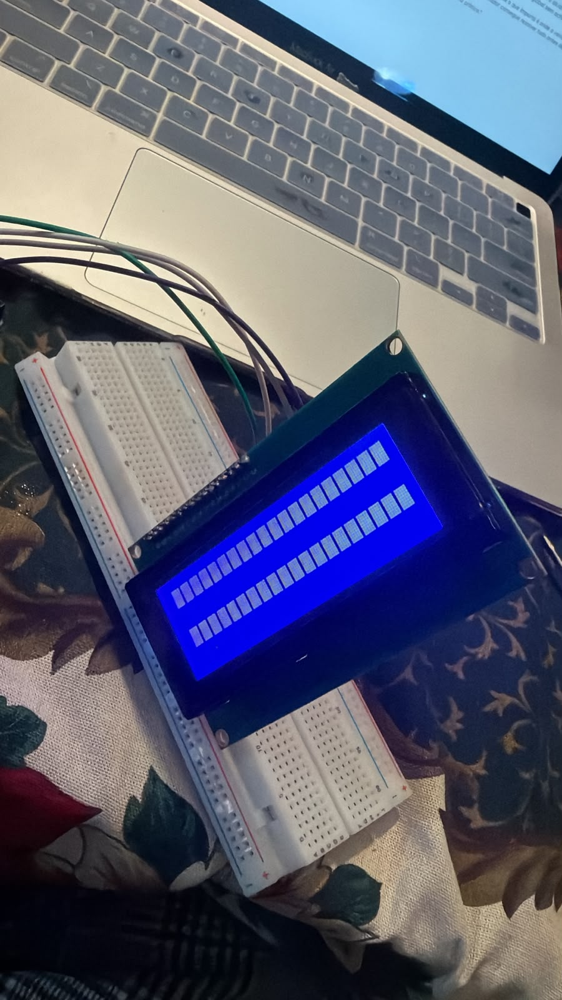
  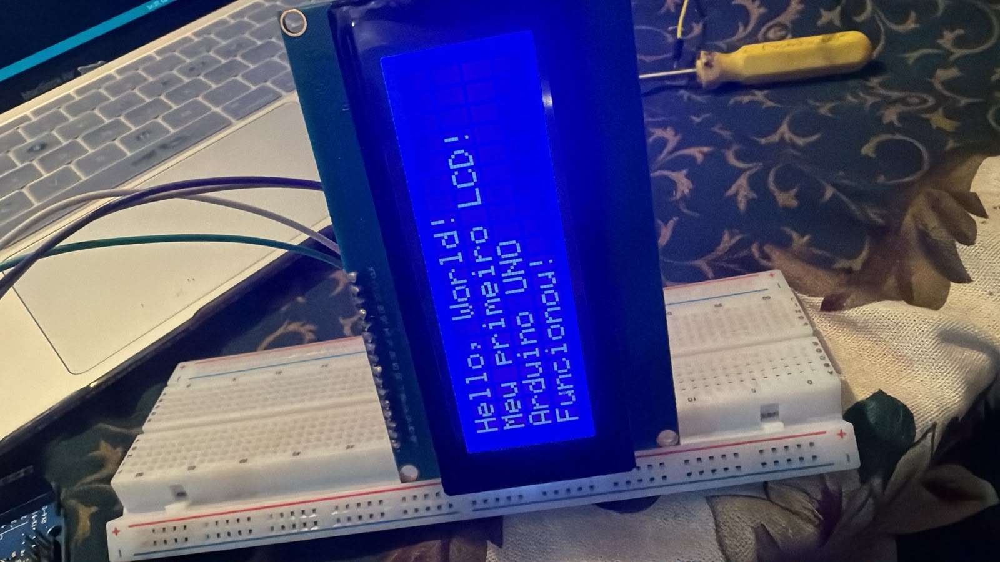
  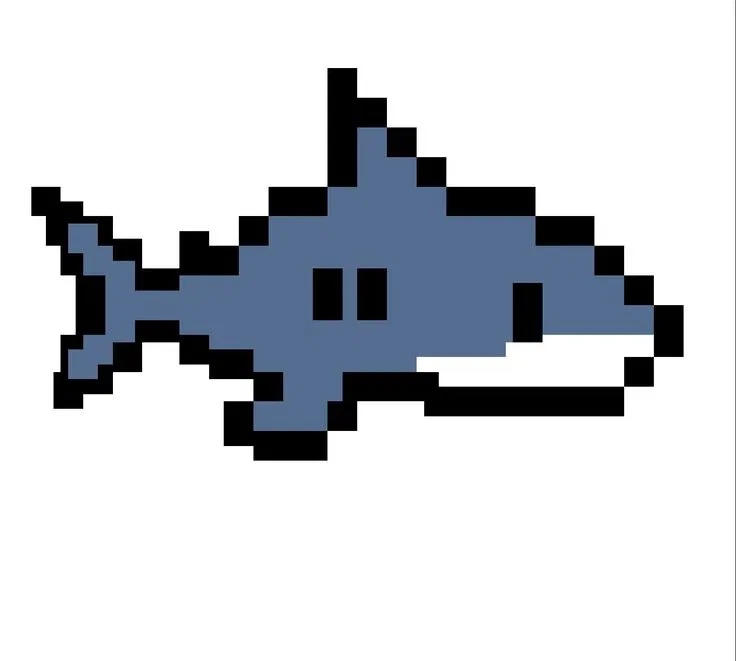
  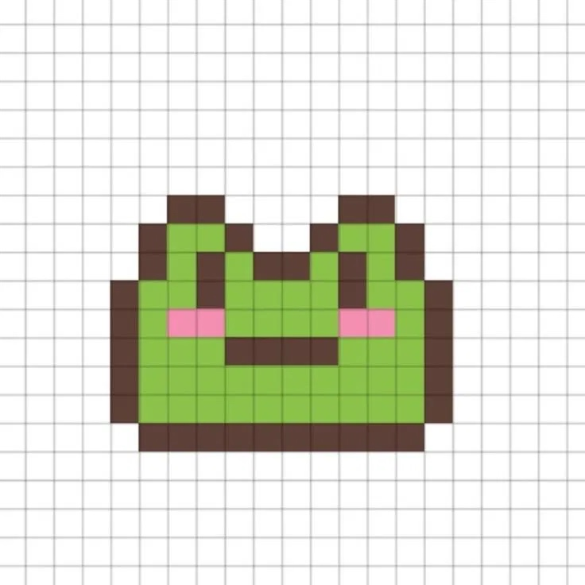
  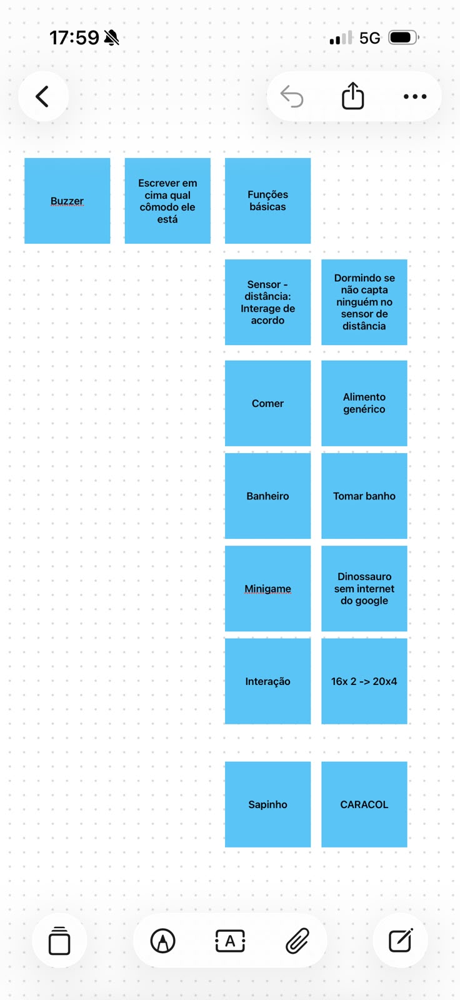
  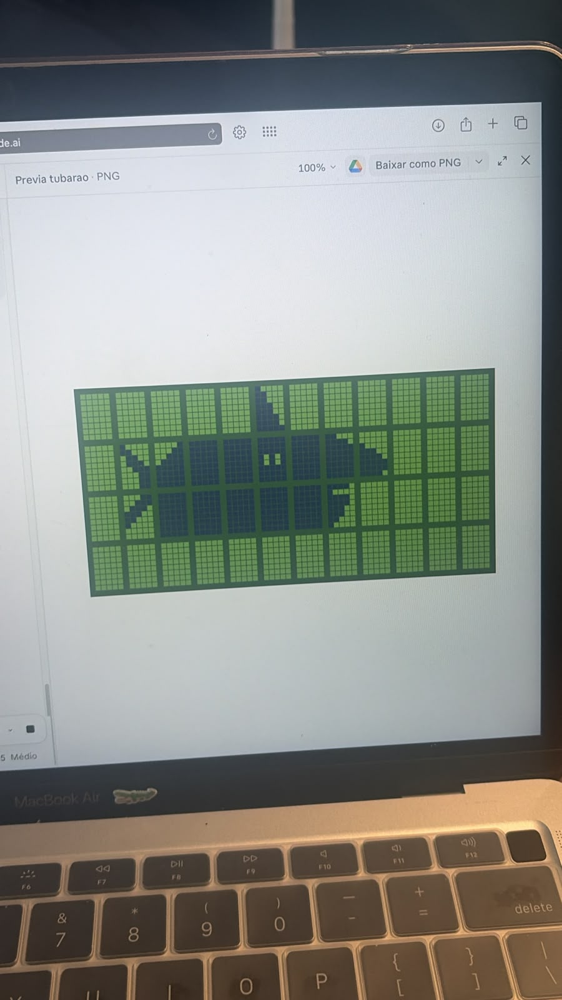
  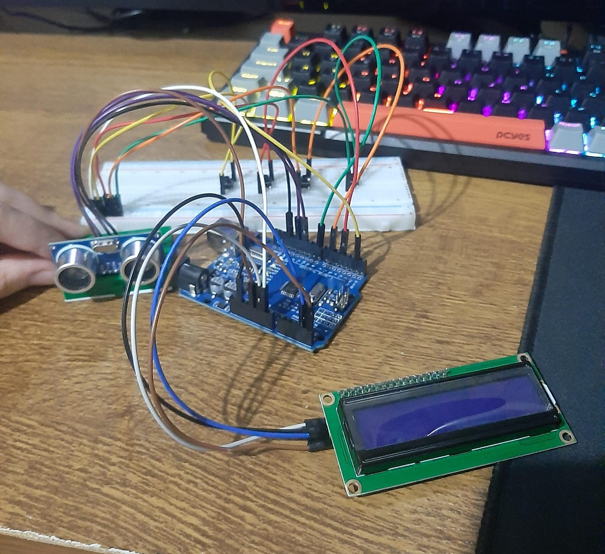
  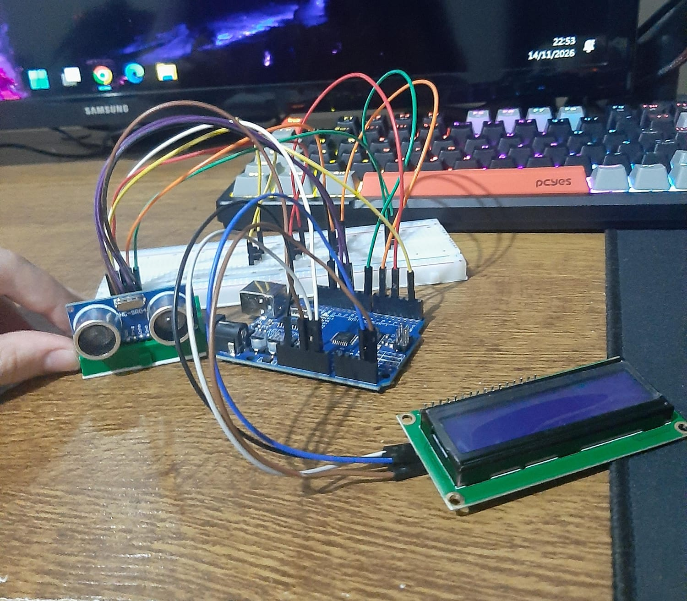
  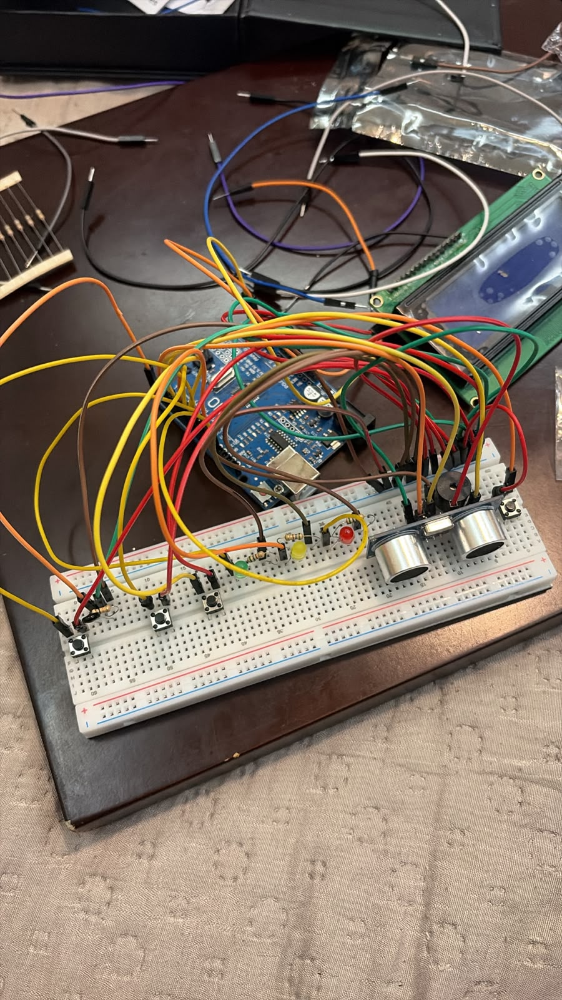
  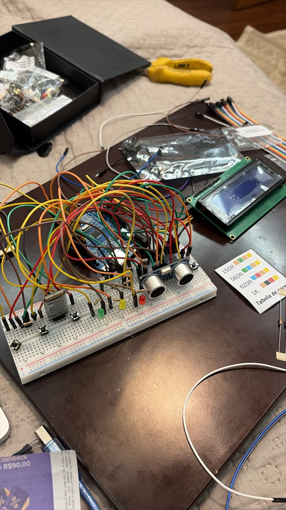
  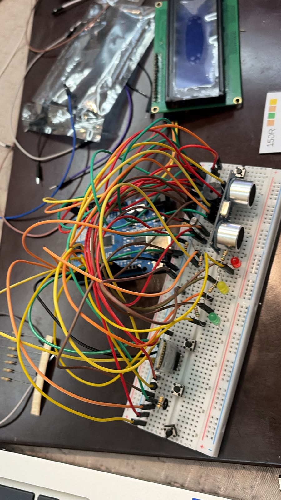
  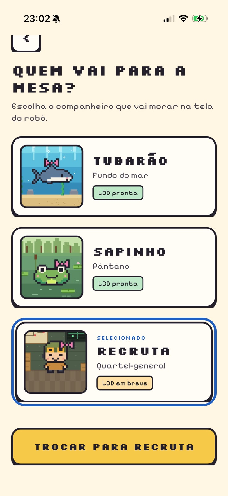
</p>

### Vídeos

- [Demonstração 1](docs/media/demonstracao-01.mp4)
- [Demonstração 2](docs/media/demonstracao-02.mp4)
- [Demonstração 3](docs/media/demonstracao-03.mp4)
- [Demonstração 4](docs/media/demonstracao-04.mp4)
- [Demonstração 5](docs/media/demonstracao-05.mp4)
- [Demonstração 6](docs/media/demonstracao-06.mp4)
- [Demonstração 7](docs/media/demonstracao-07.mp4)
- [Demonstração 8](docs/media/demonstracao-08.mp4)

## Objetivo da experiência

Além de aplicar conceitos de circuitos, sensores, comunicação serial, armazenamento em EEPROM e programação embarcada, buscamos criar uma experiência simples, lúdica e capaz de aproximar o usuário do hardware. O resultado é um projeto que une o robô físico e o aplicativo em uma única experiência de cuidado, estudo e diversão.
